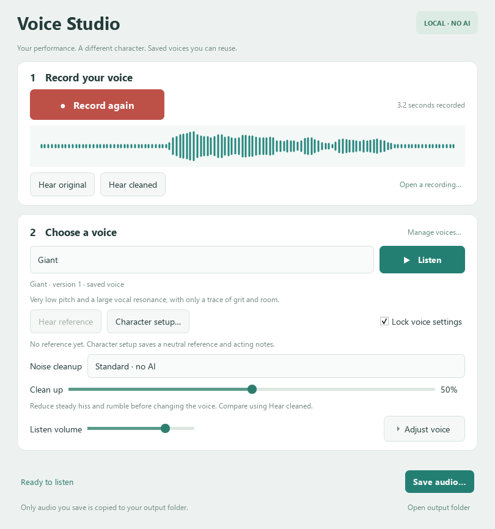

# Voice Studio

[](https://github.com/CMadden8/voice-studio/actions/workflows/windows.yml)

Record a line once and audition it as different characters. Voice Studio is a local Windows tool for game dialogue. Save the settings for a character, keep a reference performance, and use it to match the voice when you record the next scene.

**Listen to the same line** — [original performance · 3.2 s](demos/original-voice.wav?raw=true) · [Giant · 3.6 s](demos/giant.wav?raw=true)

The Giant preset lowers the pitch by six semitones, shifts the resonance and slows the delivery slightly. The demo uses standard local noise cleanup. The words, timing of the performance and expression come from the actor.



## Run on Windows

Install [64-bit Python 3.11](https://www.python.org/downloads/windows/) with the Windows Python launcher. Download and extract the repository or clone it. From the project folder run:

```bat
.\setup.cmd
.\Start.cmd
```

Setup creates a private Python environment and downloads the pinned Rubber Band executable from its publisher. After setup, audio processing runs locally. To try it without a microphone, click **Open a recording…**, choose `demos/original-voice.wav`, select **Giant**, and use **Hear original** and **Listen** to compare.

## Record the same character next week

1. Choose a preset, adjust it and save a voice revision. **Lock voice settings** keeps that recipe in place.
2. Open **Character setup** and record a neutral reference phrase. Save acting notes such as accent, pace or vocal placement alongside it.
3. In a later session, repeat the phrase and select **Calibrate this session**. The app compares voiced pitch and recording level, then applies a small fixed correction for that session. Large differences prompt a retake. The actor still supplies the accent and performance.
4. Compare the original, cleaned and character versions. **Save audio…** exports to a character folder under `Music\Voice Studio` by default. Recordings, presets and version history live in `%LOCALAPPDATA%\LocalAudioTools\Voice Studio`.

## How it works

The application handles recording, versioned character recipes, reference matching, input checks and exports. [The audio engine](src/engine.py) uses Praat through Parselmouth for voiced speech and Rubber Band R3 for material such as whispers where pitch tracking is unreliable. NumPy and SciPy handle level measurement, filtering and conventional noise reduction. The audio workers run separately from the PySide6 interface.

The standard path uses no trained models. An optional [Resolve Studio bridge](src/resolve_bridge.py) can send a take to an independently installed DaVinci Resolve Studio for **AI Voice Isolation** before the character effects run. Resolve is proprietary and optional. The app records the cleanup provider and voice revision with the export.

## Test

```powershell
$env:QT_QPA_PLATFORM = "offscreen"
.\.venv\Scripts\python.exe -m pytest -q
```

The tests exercise real voice workers, verify that inputs survive exports, and check calibration limits and preset versioning. The Resolve tests use a simulated editor connection. Consult the [engine and licence notes](docs/engines.md) for dependencies and limitations.

Application source is [GPL-3.0-or-later](LICENSE). The two [demo recordings](demos/README.md) are provided separately for listening and evaluation.
